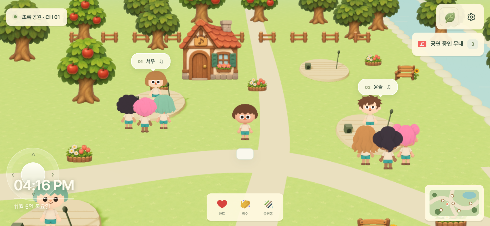
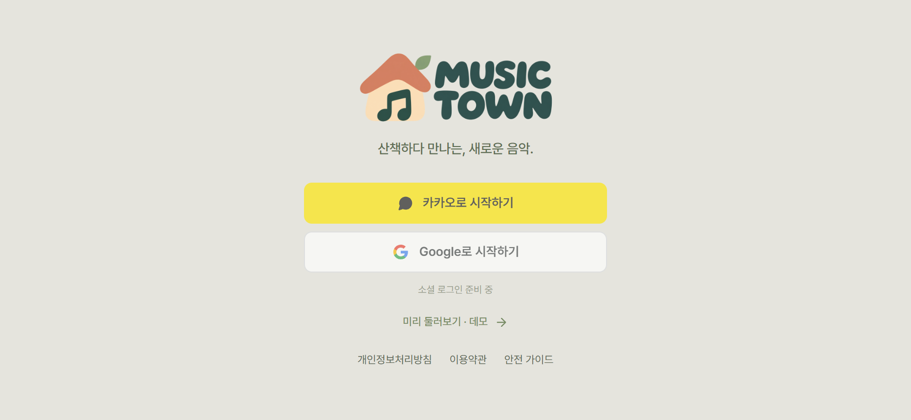
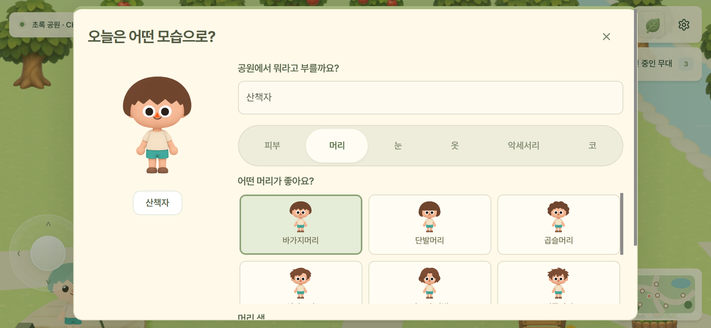
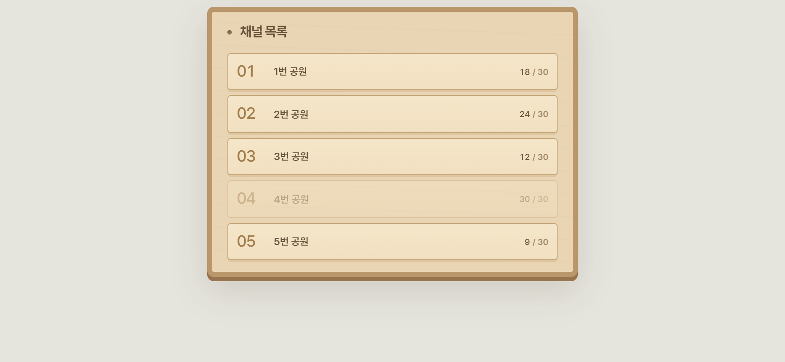
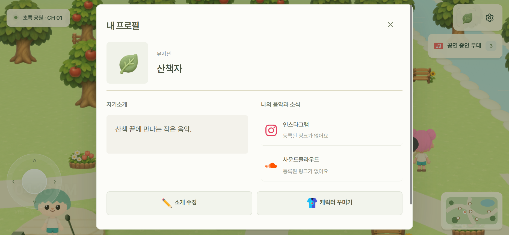
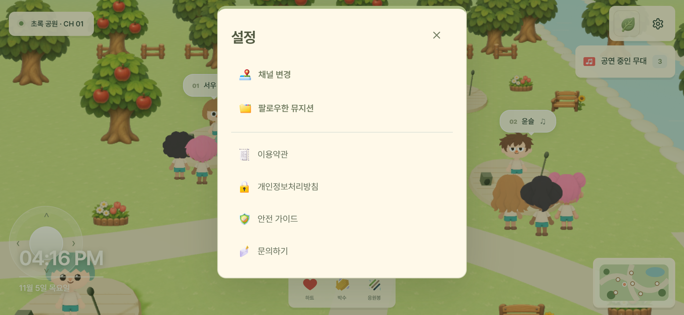
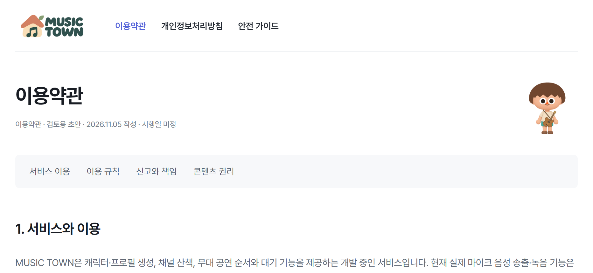
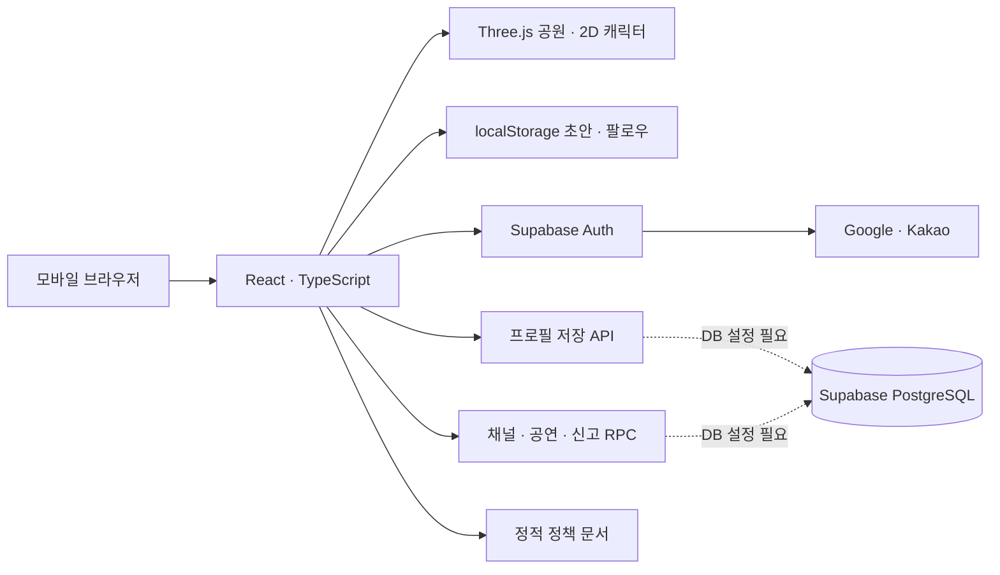

<p align="center">
  
</p>

# 산책하다 만나는, 새로운 음악. MUSIC TOWN

나만의 캐릭터로 공원을 걷고, 작은 무대 앞에서 하트와 박수로 응원을 보내 보세요.

모바일 **가로 화면**을 위한 공원 버스킹 웹앱을 만들고 있습니다.

| Type | Link |
| --- | --- |
| 소스 코드 | [Hongttochi/music_town](https://github.com/Hongttochi/music_town) |
| 문의 | [teamsda01@gmail.com](mailto:teamsda01@gmail.com) |
| 로그인 연결 | [Google · Kakao 설정 안내](docs/auth-setup.md) |

<br />

## Screenshots

모바일 가로 화면에서 촬영한 개발용 데모입니다. 화면의 인원과 뮤지션은 예시 데이터이며, 로그인 화면은 OAuth 미설정 상태입니다.

### 공원 산책



| 로그인 | 캐릭터 꾸미기 |
| :---: | :---: |
|  |  |

| 채널 선택 | 내 프로필 |
| :---: | :---: |
|  |  |

| 설정 | 이용약관 |
| :---: | :---: |
|  |  |

<br />

## Features

| 기능 | 설명 |
| --- | --- |
| 공원 산책 | 터치 조이스틱으로 이동하는 3D 공원과 캐릭터 추적 카메라 |
| 캐릭터 꾸미기 | 머리·눈·피부색, 의상, 액세서리와 악기 선택 |
| 프로필 | 배지, 자기소개, 인스타그램·사운드클라우드 링크 |
| 채널과 무대 | 5개 채널, 6개 버스킹 자리, 공연 신청과 대기 UI |
| 응원 | 하트·박수·응원봉 리액션 애니메이션 |
| 이용자 보호 | 다른 이용자 프로필에서 신고 접수, 정책 문서와 안전 가이드 |

채널·프로필 저장·신고 접수는 Supabase 설정이 필요합니다. 실제 마이크 음성 전송은 아직 구현되지 않았습니다.

<br />

## Architecture



클라이언트 코드의 연결 구조입니다. 운영 DB 구성과 원격 기능 검증은 배포 전 확인 항목을 참고하세요.

<br />

## 실행

```sh
npm install
npm run dev
```

`http://127.0.0.1:5173`에서 실행합니다. Windows PowerShell에서 실행 정책 오류가 나면 `npm.cmd`를 사용합니다.

```sh
npm run build
```

TypeScript 검사 후 `dist/`에 배포 파일을 생성합니다.

## 기술 구성

- React 19 + TypeScript + Vite
- Tailwind CSS 4: Vite 플러그인, 유틸리티 기반 UI 구성
- Three.js / WebGL: 3D 공원과 추적 카메라. 캐릭터는 AI 생성 투명 이미지의 4방향 스프라이트로 표시하며 이동 시 흔들림/상하 움직임을 적용합니다. 관절 기반 걷기 애니메이션은 아닙니다.
- Lucide React 아이콘
- PWA manifest: 홈 화면용 기본 메타데이터. 서비스 워커와 푸시는 미구현

## 체험

로그인 → 캐릭터 설정 → 채널 선택 → 공원 입장. 실제 로그인 연결은 [인증 설정 안내](docs/auth-setup.md)를 따릅니다. 인증 설정이 없는 개발 서버에서는 '개발용 체험'으로 설정 화면을 확인할 수 있습니다. 프로덕션에는 이 우회 버튼이 없습니다.

- 키보드 WASD/방향키 또는 터치 조이스틱으로 산책
- 5개 채널, 채널당 30명 상한 표시, 가득 찬 채널 입장 차단
- 6개 버스킹 자리, 다른 이용자 프로필 열기, 팔로우, 개별 음소거 상태, 서버 신고 접수 UI
- 캐릭터 외형·의상·장비·프로필 배지를 선택합니다. 로그인 이용자의 프로필은 Supabase 저장 API에 연결되어 있으며, 편집 초안과 팔로우는 계정 ID별로 브라우저에 저장합니다.
- 무음 리액션 애니메이션, 한국 시간 기준 낮/저녁/밤
- 실제 계정의 채널·공연·대기열 상태는 Supabase RPC를 통해 갱신합니다. DB 적용과 두 계정 검증이 필요합니다.
- 모바일 세로 화면은 가로 전환 안내, PC는 모바일 지원 안내를 표시합니다. 터치 조작, 노치 여백, 키보드 높이와 짧은 가로 화면에 대응합니다.

## 프로토타입 범위

개발용 체험은 가상 데이터를 사용합니다. 실제 계정 모드에는 로그인·프로필·채널·참가자·공연 대기열·신고 RPC 클라이언트가 구현되어 있습니다. 마이크/WebRTC 전송, 녹음과 실제 음성 믹싱은 미구현이며 리액션은 현재 사용자 화면에서만 표시됩니다.

운영 환경의 OAuth 설정, DB 권한과 RPC, 신고 운영 절차, 실제 모바일 성능은 배포 전에 검증해야 합니다. 신고 접수는 DB 저장 방식이며 운영자 이메일 자동 발송이나 푸시는 구현되어 있지 않습니다.

## 배포 전 확인

### Vercel

1. Vercel에서 `Hongttochi/music_town` GitHub 저장소를 Import합니다. Root Directory는 저장소 루트입니다.
2. Framework Preset은 **Vite**입니다. `vercel.json`에 설치 명령 `npm ci`, 빌드 명령 `npm run build`, 출력 폴더 `dist`를 지정했습니다.
3. Environment Variables에 `VITE_SUPABASE_URL`, `VITE_SUPABASE_PUBLISHABLE_KEY`를 등록한 뒤 Deploy합니다. 환경 변수를 바꾸면 재배포해야 합니다.
4. Supabase Authentication의 Site URL과 Redirect URLs에 실제 Vercel 배포 주소를 등록합니다. 이 앱의 로그인 복귀 주소는 `https://배포도메인/`입니다.
5. 모바일 가로 화면으로 로그인·프로필·채널 입장을 확인하고 `/terms/`, `/privacy/`, `/safety/`도 직접 열어 확인합니다.

정책 문서는 각 정적 HTML로 연결하며, 앱은 `/`에서 실행됩니다. 기존 `.openai/hosting.json`은 제거했습니다. Vercel 대시보드에서 프로젝트 연결과 환경 변수 등록은 별도로 진행해야 합니다.

설정 기준: [Vercel의 Vite 배포 안내](https://vercel.com/docs/frameworks/frontend/vite), [vercel.json 설정](https://vercel.com/docs/project-configuration/vercel-json).

### 서비스 연결 확인

- 빌드 시 `VITE_SUPABASE_URL`, `VITE_SUPABASE_PUBLISHABLE_KEY`를 주입합니다. `.env`와 비밀키는 Git에 올리지 않습니다.
- OAuth Site URL과 Redirect URLs를 실제 배포 주소에 맞춥니다.
- **현재 저장소에는 안내 문서에서 참조하는 `supabase/migrations/*.sql`과 `tests/*.test.mjs`가 없습니다.** DB 파일을 확보하고 실제 스키마·권한·RPC를 확인한 뒤 로그인, 채널 입장, 신고 접수를 검증해야 합니다. 프런트엔드 빌드 성공만으로 DB 동작을 보장하지 않습니다.
- 정적 호스팅은 `dist/`를 사용하고 `/terms/`, `/privacy/`, `/safety/`의 HTML 파일을 SPA fallback보다 먼저 제공합니다.
- 개인정보처리방침과 약관은 검토용 초안입니다. 운영 정보와 시행일을 확정해야 합니다.
- 이번 작업은 소스 푸시이며, 별도의 컨테이너 이미지 빌드·레지스트리 푸시나 운영 배포는 수행하지 않았습니다.

## 파일 구성

- `src/main.tsx`: React UI 및 프로토타입 상태
- `src/Park.tsx`: Three.js 3D 공원, 카메라, 캐릭터, 입력 처리
- `src/imageCharacter.ts`: AI 이미지 4방향 아틀라스 로딩 및 방향 전환
- `public/art/`: AI 생성 기본 몸체·머리·눈·코 부품, 마을 소품·잔디 텍스처·MUSIC TOWN 로고
- `src/modularAvatar.ts`, `src/avatarParts.ts`: 부품별 캐릭터 조합과 4방향 합성
- `src/ModularPortrait.tsx`, `src/PartOptions.tsx`: 부품 선택 및 공통 미리보기
- `src/villageProps.ts`: 마을 이미지 소품, 잔디 텍스처 로딩
- `public/icons/ATTRIBUTION.md`: 실제 Flaticon 아이콘 원작자·출처. 앱 화면에서도 확인 가능
- `src/AvatarEditor.tsx`: 로그인 후 캐릭터 설정
- `src/LoginGate.tsx`, `src/auth.ts`: 세션 기반 입장 흐름과 Supabase OAuth
- `src/appearance.ts`, `src/characterTexture.ts`: 피부/눈동자 색상 변경과 공통 렌더링
- `src/model.ts`: 타입, 가상 데이터, 공통 계산
- `src/style.css`: Tailwind 진입점, 공원 HUD 스타일, 반응형 레이아웃
- `public/`: 앱 아이콘과 manifest

## 검증

`npm run build`로 TypeScript와 Vite 빌드를 확인합니다. `node scripts/check-avatar.mjs`와 `node scripts/check-clothing.mjs`로 캐릭터 합성 이미지를 생성할 수 있습니다. 전체 브라우저/터치 기기 시각 검증과 운영 DB 검증은 미완료입니다. 과거 UI 점검 기록은 [design-qa.md](design-qa.md)를 참고하세요.

## Credits

- 아이콘: [Flaticon 원작자 및 출처](public/icons/ATTRIBUTION.md)
- 문서 폰트: Pretendard · [OFL 라이선스](public/fonts/OFL.txt)
- 스크린샷: 현재 앱의 로컬 데모를 Chromium 모바일 에뮬레이션으로 캡처했습니다. 실제 휴대폰 촬영이나 성능 검증을 뜻하지 않습니다.
