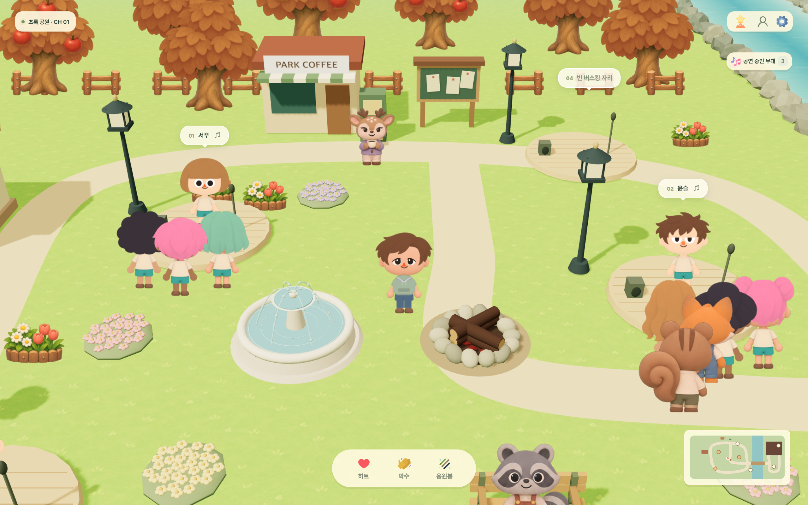
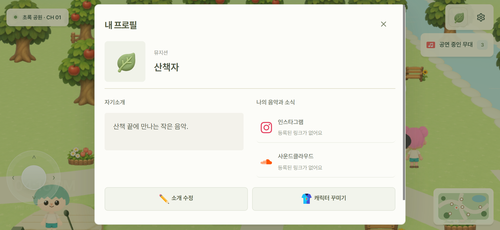
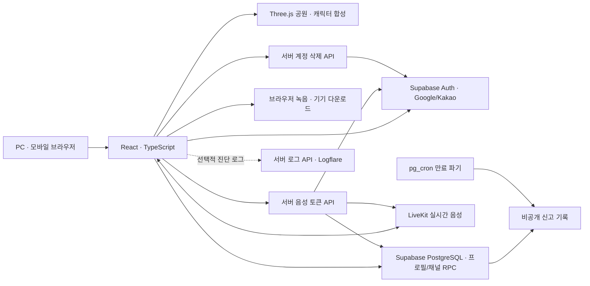

<p align="center">
  
</p>

# 산책하다 만나는, 새로운 음악. MUSIC TOWN

나만의 캐릭터로 공원을 걷고, 작은 무대에서 노래하거나 다른 사람의 공연을 들어 보세요.
동물 주민들이 산책하고 대화를 나누는 공원에 카페, 강변, 밤에 문을 여는 라이브 바가 함께 있습니다.

PC 웹과 모바일 가로 화면을 지원하는 음악 소셜 웹앱입니다. **출시 예정일은 2026년 11월 22일**이며, 이 문서는 2026년 11월 15일 소스 기준입니다.

[릴리스](https://github.com/Hongttochi/music_town/releases) · [개발 규칙](CONTRIBUTING.md) · [개인정보 보관 기준](docs/privacy-retention-policy.md) · [문의](mailto:teamsda01@gmail.com)

## 주요 기능

| 기능           | 내용                                                                               |
| -------------- | ---------------------------------------------------------------------------------- |
| 공원 산책      | 키보드·터치 조이스틱 이동, 낮·저녁·밤 변화, 강변·카페·벤치·모닥불                  |
| 캐릭터 꾸미기  | 머리·눈·피부·의상·악세서리·악기와 프로필 아이콘 선택, 방향에 따른 걷기·앉기·마시기 |
| 동물 주민      | 산책, 벤치 휴식, 커피 마시기, 서로 마주 보고 대화하기와 기쁨·슬픔 표정             |
| 채널·공연      | 3개 공원 채널, 야외 무대 6곳과 바 무대 1곳, 공연 신청·대기·관람                    |
| 실시간 음성    | LiveKit 기반 마이크 송출·공연 청취, 무대별 음소거, 마이크 음향 설정                |
| 본인 공연 녹음 | 직접 시작·종료하고 브라우저에서 재생·다운로드. 녹음 파일의 서버 업로드 없음        |
| 팬 활동        | 팔로우·하트, 팔로우한 사람 목록, 주간·누적 하트 랭킹과 지난주 기록                 |
| 프로필         | 자기소개·Instagram·SoundCloud 링크, 접속·무대 시간과 최근 7일 그래프               |
| 분위기와 반응  | 하트·박수·응원봉, 발걸음·환경음·배경음, 볼륨 조절                                  |
| 이용자 보호    | 신고 접수, 계정 탈퇴, 개인정보처리방침·이용약관·안전 가이드                        |

바는 한국 시간 19:00~06:00에 운영됩니다. 공연 음성과 계정·채널·신고 저장 기능은 Supabase와 LiveKit의 실제 환경 설정이 필요합니다. 동물 주민과 개발용 체험의 뮤지션은 실제 접속자가 아닙니다.

## 화면 미리보기

아래는 **2026년 11월 5일 개발용 데모**를 모바일 가로 화면으로 캡처한 자료입니다. 최신 UI와 차이가 있으며 화면의 인원·뮤지션은 예시 데이터입니다. [캡처 조건과 전체 이미지](docs/screenshots/README.md)



|                                        캐릭터 꾸미기                                        |                                            내 프로필                                            |
| :-----------------------------------------------------------------------------------------: | :---------------------------------------------------------------------------------------------: |
|  |  |

## 시작하기

Node.js 22와 npm을 사용합니다. CI도 Node.js 22에서 실행합니다.

```sh
npm ci
cp .env.example .env
npm run dev
```

`http://127.0.0.1:5173`으로 접속합니다. Windows에서는 `.env.example`을 `.env`로 복사하고, PowerShell 실행 정책 오류가 발생하면 `npm.cmd`를 사용합니다.

Supabase 설정이 없는 개발 서버에서는 로그인 화면의 **개발용 체험**으로 공원을 둘러볼 수 있습니다. 이 버튼은 프로덕션 빌드에 포함되지 않습니다. 실제 계정 흐름은 Google·카카오 로그인 → 캐릭터·프로필 설정 → 채널 선택 → 입장 순서입니다.

- **PC:** WASD 또는 방향키로 이동하고 마우스로 메뉴·상호작용을 선택합니다.
- **모바일·태블릿:** 가로 화면에서 터치 조이스틱을 사용합니다. 세로 화면에서는 회전 안내가 표시됩니다.
- **공연:** 무대에서 공연을 신청하거나 대기합니다. 송출 시 마이크 권한이 필요합니다.
- **관람:** 무대 프로필에서 듣기·음소거·신고를 선택할 수 있습니다.

## 환경 설정

전체 항목은 [.env.example](.env.example)을 기준으로 설정합니다. 비밀키에는 `VITE_` 접두사를 붙이지 않습니다.

| 변수                                     | 위치           | 용도                                                           |
| ---------------------------------------- | -------------- | -------------------------------------------------------------- |
| `VITE_SUPABASE_URL`                      | 브라우저·서버  | Supabase 프로젝트 URL                                          |
| `VITE_SUPABASE_PUBLISHABLE_KEY`          | 브라우저·서버  | 공개용 키. DB의 RLS·RPC 권한 설정 필요                         |
| `SUPABASE_SECRET_KEY`                    | 서버 전용      | 인증된 본인 계정 삭제. 기존 `SUPABASE_SERVICE_ROLE_KEY`도 지원 |
| `LIVEKIT_URL`                            | 서버 전용 설정 | 음성 서버 주소                                                 |
| `LIVEKIT_API_KEY`, `LIVEKIT_API_SECRET`  | 서버 전용      | 공연 권한을 확인한 뒤 음성 토큰 발급                           |
| `VITE_LOGGING_ENABLED`                   | 브라우저       | 진단 로그 활성화. 기본 `false`                                 |
| `LOGFLARE_SOURCE_ID`, `LOGFLARE_API_KEY` | 서버 전용      | 선택적 진단 로그 전송                                          |
| `LOG_ALLOWED_ORIGINS`                    | 서버 전용      | 로그 API에서 허용할 프런트엔드 origin 목록                     |

`npm run dev`는 Vite와 개발용 `/api/voice-token` 미들웨어를 실행합니다. `/api/delete-account`, `/api/logs`까지 확인하려면 Vercel 개발 환경 또는 배포 환경을 사용합니다. `npm run preview`는 정적 빌드 미리보기입니다.

| 설정 문서                                   | 확인할 내용                                  |
| ------------------------------------------- | -------------------------------------------- |
| [Google·카카오 로그인](docs/auth-setup.md)  | OAuth 제공자, 콜백 URL, Supabase 인증 설정   |
| [멀티플레이](docs/multiplayer-setup.md)     | 계정·채널·공연·대기열 및 계정 삭제           |
| [실시간 음성](docs/live-audio-setup.md)     | LiveKit 연결, 마이크, 서버 토큰 검증         |
| [팬·활동 통계](docs/profile-stats-setup.md) | 팔로우·하트·접속 시간 SQL                    |
| [하트 랭킹](docs/heart-rankings.md)         | 주간·누적 랭킹                               |
| [신고·만료 파기](docs/reporting-setup.md)   | 신고 RPC, 별도 보관, 관리자 처리, Cron       |
| [운영 로그](docs/logflare-setup.md)         | Logflare 전송 범위, 환경 변수, 보유기간 설정 |

### 데이터베이스 준비 상태

저장소에는 팬·활동 통계·랭킹·바 무대·신고 보관 마이그레이션과 관련 테스트가 있습니다. 다만 초기 `202611050001_member_profiles.sql`, `202611050002_multiplayer.sql`은 현재 저장소에 없습니다. **빈 Supabase 프로젝트에 이 저장소의 SQL만 순서대로 실행하여 전체 DB를 구성할 수는 없습니다.** 신규 환경에서는 기존 스키마와 권한 정의를 먼저 확보해야 합니다.

이미 구성된 DB에는 변경분만 적용합니다. 과거 `town_action` 정의를 다시 실행하면 활동 통계 래퍼를 덮어쓸 수 있습니다. 이번 신고 보관 변경은 다음 순서로 적용합니다.

1. [신고 보관 SQL](supabase/migrations/202611150001_report_retention.sql) 적용.
2. 기존 사건의 보존 필요성과 기한 검토.
3. [매시간 파기 Cron SQL](supabase/migrations/202611150002_report_retention_cron.sql) 적용.
4. 테스트 계정으로 접수·탈퇴·신고 보존·만료 파기를 확인하고 Cron 실행 이력 점검.

이 두 SQL은 로컬에서 준비한 변경이며 **운영 DB 적용과 스케줄 실행은 아직 확인하지 않았습니다.** 상세 절차는 [신고 운영 문서](docs/reporting-setup.md)를 따릅니다.

## 개인정보와 이용자 보호

일반 계정 정보는 탈퇴 시 삭제하고, 신고 사건은 계정과 분리하여 필요한 범위에서 처리합니다.

| 구분                            | 보관 기준                                                  |
| ------------------------------- | ---------------------------------------------------------- |
| 계정·프로필·연결된 팬 활동·통계 | 탈퇴 시 삭제                                               |
| 일반 문의·일반/기각 신고        | 처리 완료 후 최대 90일                                     |
| 확인된 위반·분쟁 기록           | 필요성과 적법한 근거가 확인된 최소 자료만 종결 후 최대 1년 |
| 수사·소송 등 예외 보존          | 근거·범위·종료일 기록, 30일 이내 재검토                    |

1년은 모든 신고에 적용되는 법정 의무 기간이 아닙니다. 개인정보처리방침의 기재만으로 보관 근거가 생기지도 않습니다. 운영 판단과 구현 범위는 [보관 기준](docs/privacy-retention-policy.md)에 정리했습니다.

신고 자료를 위해 이메일·소셜 계정 원본·인증 토큰을 복제하거나 공연을 상시 녹음하지 않습니다. 본인 공연 녹음은 이용자가 직접 시작하며 파일은 브라우저에서 내려받습니다. Amplitude는 아직 연동하지 않았습니다.

[개인정보처리방침](public/privacy/index.html) · [이용약관](public/terms/index.html) · [안전 가이드](public/safety/index.html)

방침·약관의 시행 예정일은 2026년 11월 22일입니다. 운영 파기 검증, 공급자 로그·백업 보유기간 및 국외 이전 세부사항이 남아 있어 현재 검토본으로 관리합니다. 이메일 문의함 삭제는 DB 정기 파기와 별도 운영 절차입니다.

## 구조



| 위치                     | 역할                                                 |
| ------------------------ | ---------------------------------------------------- |
| `src/pages`, `src/app`   | 로그인·프로필 로딩·공원 화면 흐름                    |
| `src/components`         | 공원·공연·프로필·설정·신고 UI                        |
| `src/hooks`              | 채널 상태, 음성, 마이크, 녹음, 오디오, 장면 생명주기 |
| `src/scene/park`         | 지형·시설, 주민 행동, 이동·벤치 충돌, 라벨           |
| `src/scene/avatar`       | 캐릭터 부품 합성, 방향·걷기·앉기·마시기              |
| `src/services`           | 인증, 프로필 저장, 진단 로그 전송                    |
| `src/data`, `src/sounds` | 캐릭터·공원 설정과 음원                              |
| `api`                    | 음성 토큰·계정 삭제·로그 서버 API                    |
| `supabase/migrations`    | PostgreSQL 기능 및 보관·파기 변경                    |
| `tests`, `scripts`       | API·DB·동작 테스트와 렌더링 점검                     |
| `public`                 | 이미지·아이콘·글꼴·정적 정책 문서                    |
| `docs`                   | 서비스 설정과 운영 절차                              |

React 19, TypeScript, Vite 6, Three.js, Supabase, LiveKit을 사용합니다. 스타일은 CSS와 Tailwind CSS 4, 아이콘은 PNG와 Lucide React로 구성합니다. 캐릭터는 3D 공간에 표시하는 2D 합성 이미지이며 방향·상태별 렌더링을 사용합니다.

## 검증

```sh
npm test
npm run build
```

`npm test`는 Node 테스트 러너로 API 권한, PGlite 기반 DB/RLS·보관 기한, 이동·주민 행동·음성·캐릭터 렌더링 등을 확인합니다. `npm run build`는 TypeScript 검사 후 `dist/`를 생성합니다.

이번 보관 변경만 확인하려면 다음을 실행합니다.

```sh
node --test tests/report-retention.test.mjs tests/delete-account.test.mjs tests/profile-stats.test.mjs
```

추가 렌더링 점검은 `scripts/check-avatar.mjs`, `scripts/check-clothing.mjs`, `scripts/check-seating.mjs`를 사용합니다. 로컬 테스트는 실제 두 계정의 동시 접속, 휴대폰 마이크·재생, 운영 DB와 공급자 설정 검증을 대신하지 않습니다.

## 배포와 출시 준비

Vercel 설정은 [vercel.json](vercel.json)에 있습니다. 설치 `npm ci`, 빌드 `npm run build`, 출력 `dist/`를 사용하며 `/terms/`, `/privacy/`, `/safety/`를 각각의 정적 HTML로 제공합니다.

1. 배포 환경에 공개 변수와 서버 전용 비밀키를 구분해 등록합니다.
2. OAuth Site URL·Redirect URLs 및 로그 허용 origin을 실제 도메인에 맞춥니다.
3. 필요한 DB 변경과 신고 파기 작업을 적용하고 RLS·RPC 접근 권한을 검증합니다.
4. 두 계정으로 로그인·채널 입장·공연 대기·송출/청취·신고·탈퇴를 확인합니다.
5. 모바일 가로 화면에서 이동·마이크·음성 재생과 정책 페이지 접근을 확인합니다.
6. 공급자 보유기간·국외 이전 정보 및 운영 절차를 확정하고 정책 최종본을 공개합니다.

일반 변경은 작업 브랜치 → `develop` PR → `main` 배포 PR 순서로 반영합니다. CI는 `npm test`와 빌드를 실행합니다. 운영 배포를 확인한 `main` 커밋에 `vX.Y.Z` 태그를 만들면 Release 워크플로가 검증 후 GitHub Release를 생성합니다. 이 워크플로 자체가 사이트를 배포하거나 운영 상태를 확인하지는 않습니다. [상세 개발·릴리스 규칙](CONTRIBUTING.md)

신고 접수는 DB 저장 방식이며 운영자 이메일 알림·푸시·자동 제재는 없습니다. PWA manifest는 홈 화면용 메타데이터이며 서비스 워커·오프라인 지원은 구현하지 않았습니다. 이용자 리액션은 현재 각 클라이언트 화면에서 표시합니다.

## 크레딧

- [아이콘 원작자·출처](public/icons/ATTRIBUTION.md)
- 문서 글꼴: Pretendard · [OFL 라이선스](public/fonts/OFL.txt)
- 이미지 제작·주민 애니메이션 관련 기록: [주민 아트](docs/park-resident-art.md), [표정 이미지](docs/resident-emotion-prompts.md)
- 스크린샷은 개발용 Chromium 모바일 에뮬레이션 캡처이며 실제 휴대폰 성능 검증을 뜻하지 않습니다.
