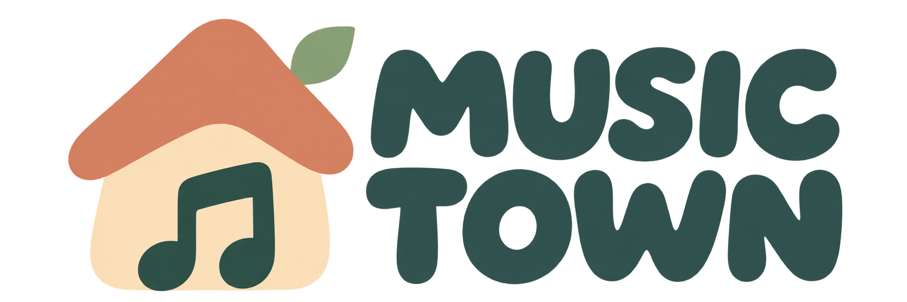
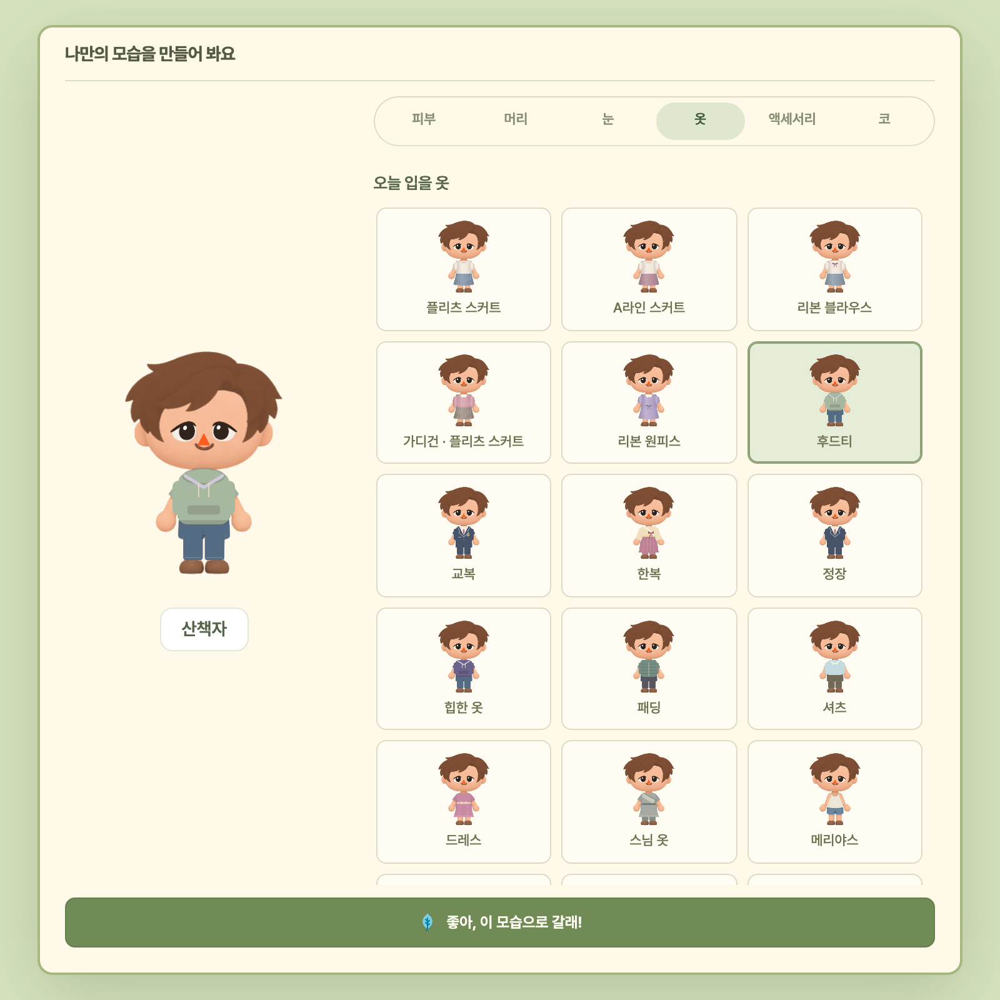
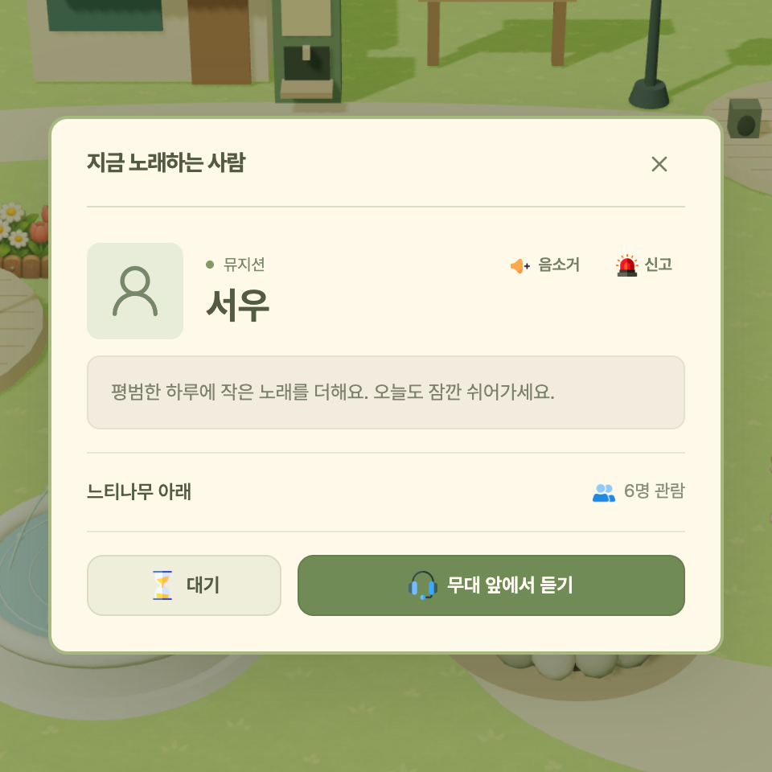

<p align="center">
  
</p>

# 산책하다 만나는, 새로운 음악

나만의 캐릭터로 공원을 걷고, 작은 무대에서 노래하거나 다른 사람의 공연을 들어 보세요.
PC와 모바일 가로 화면에서 즐기는 음악 소셜 웹앱입니다.

## 공원 둘러보기


|                                            나만의 캐릭터                                            |                                              공연 함께 듣기                                              |
| :-------------------------------------------------------------------------------------------------: | :------------------------------------------------------------------------------------------------------: |
|  |  |

<sub>2026.11.15 최신 코드의 개발용 데모를 직접 캡처했습니다. 화면 속 공연자·관람 인원은 예시입니다.</sub>

## 이런 걸 할 수 있어요

- **꾸미고 산책하기** — 캐릭터의 머리·눈·옷·액세서리를 고르고, 동물 주민이 있는 공원을 걸어요.
- **노래하고 듣기** — 무대에 올라 실시간으로 노래하거나 다른 공연을 듣고 하트와 박수로 응원해요.
- **목소리 기억하기** — 좋아하는 뮤지션을 팔로우하고 프로필·활동 기록·주간 랭킹을 확인해요.
- **잠깐 쉬어가기** — 카페에서 커피를 마시고 벤치에 앉거나 밤에 문을 여는 라이브 바를 찾아가요.
- **내 공연 간직하기** — 본인 공연을 직접 녹음해 기기에 내려받을 수 있어요.

PC에서는 **WASD·방향키**, 모바일 가로 화면에서는 **터치 조이스틱**으로 이동합니다.

## 로컬 실행

Node.js 22 이상이 필요합니다.

```sh
npm ci
npm run dev
```

`http://127.0.0.1:5173`에서 열립니다. 로그인 설정이 없는 개발 환경에서는 **미리 둘러보기 · 데모**로 체험할 수 있습니다.
실제 로그인·DB·음성 연결은 [개발 환경 설정](docs/development-setup.md)을 참고하세요.

```sh
npm test
npm run build
```

**기술:** React · TypeScript · Three.js · Vite · Supabase · LiveKit

[개발·배포 규칙](CONTRIBUTING.md) · [신고 운영](docs/reporting-setup.md) · [개인정보 보관 기준](docs/privacy-retention-policy.md) · [아이콘 출처](public/icons/ATTRIBUTION.md) · [글꼴 라이선스](public/fonts/OFL.txt) · [문의](mailto:teamsda01@gmail.com)
